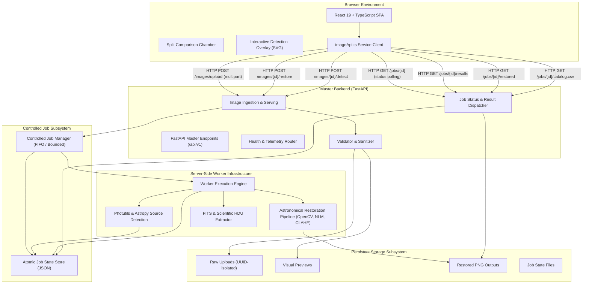

# Tsukuyomi Watch — Spirit Lens Architecture Specification

## 1. System Overview

**Tsukuyomi Watch — Spirit Lens** is a scientific full-stack platform for astronomical image restoration, photometric source extraction, and interactive celestial exploration.

The application adheres strictly to zero-cost software principles, scientific integrity (no fabricated detections or uncalibrated physical claims), bounded resource consumption, and modular master-backend architecture.



---

## 2. Component Breakdown

### A. React Frontend (`frontend/`)
- **Technology Stack**: React 19, TypeScript, Vite, Tailwind CSS v4, Lucide React.
- **Image Comparison Chamber**: Real-time draggable split-curtain comparison divider with CSS clipping, panning, and zooming (50% to 400%).
- **Interactive Detection Overlay**: SVG viewport projection registered directly to the observation coordinate system. Reticles, bounding ellipses, and centroid pips stay locked to pixel data through dynamic scaling.
- **Centralized API Client (`imageApi.ts`)**: Manages upload streams, polling with adaptive backoff, and download authorizations.

### B. FastAPI Master Backend (`backend/app/`)
- Unified backend under `/api/v1`.
- Fast non-blocking request handlers with Pydantic v2 data schemas.
- Path-traversal sanitization and byte-level MIME/content validation.
- Strictly separates API dispatch from CPU/RAM-intensive scientific processing.

### C. Controlled Job Manager (`backend/app/services/job_service.py`)
- Manages bounded concurrency (default 4 concurrent tasks, 16 queued ceiling).
- Atomic state persistence via file-swapping (`.tmp` to `.json`).
- Asynchronous thread-pool executor maintains responsive HTTP server throughput even under heavy compute jobs.

### D. Standalone Worker Process (`worker/main.py`)
- Independent process that can run in a separate container, machine, or daemon.
- Polls the shared job directory and claims tasks with concurrency limits.

### E. Scientific Astronomical Pipelines (`ai/`)
1. **Classical Restoration Pipeline (`ai/restoration/classical_restoration.py`)**:
   - Non-Local Means Poisson/read denoising.
   - Contrast Limited Adaptive Histogram Equalization (CLAHE) for revealing faint nebular filaments without saturating star cores.
   - Unsharp masking for stellar profile sharpening.
   - Morphological background gradient leveling.
2. **Celestial Source Extraction (`ai/detection/source_detection.py`)**:
   - 2D spatial background and noise RMS modeling (`photutils.background.Background2D`, `astropy.stats.sigma_clipped_stats`).
   - Image segmentation (`photutils.segmentation.detect_sources`) and `SourceCatalog`.
   - Photometric instrumental flux extraction and candidate morphology categorization (point candidates vs extended candidates).
   - DAOStarFinder fallback.

---

## 3. Scaling to Remote GPU Workers

The decoupled architecture allows scaling without changing frontend or API contracts:

```
[FastAPI Server] ──> [Message Broker (e.g. RabbitMQ / Redis / S3)] ──> [Remote GPU Worker (PyTorch / CUDA)]
```

1. **Storage Decoupling**: Replace local disk storage in `StorageService` with S3/MinIO/GCS object storage via presigned URLs.
2. **Queue Decoupling**: Switch `JobService` from filesystem/threadpool to Celery, Redis RQ, or Google Cloud Pub/Sub.
3. **GPU Inference Engine**: Mount PyTorch or ONNX-Runtime in `ai/restoration/model_loader.py` targeting CUDA/ROCm instances.
